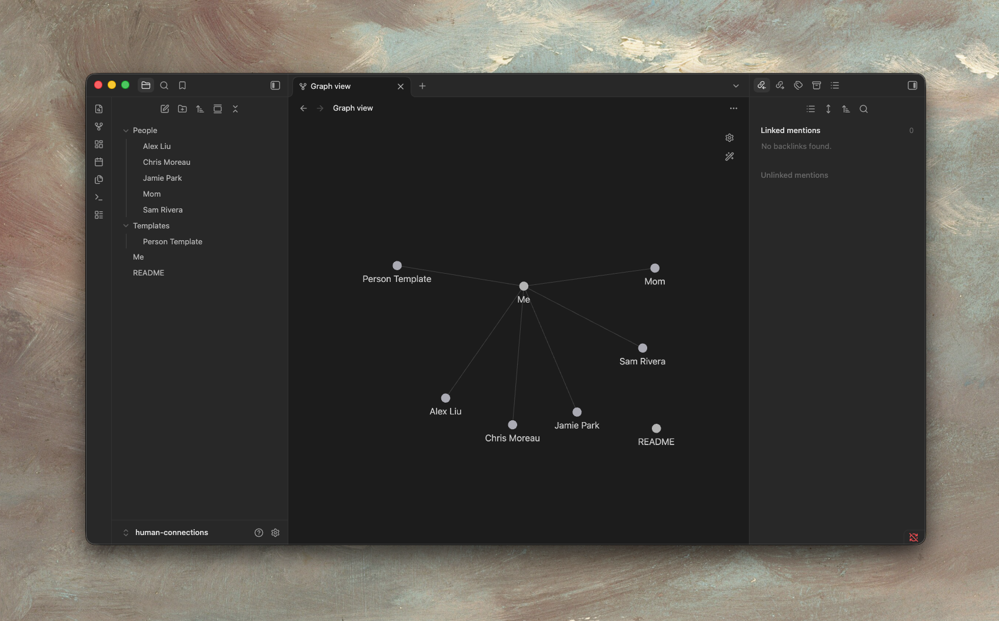
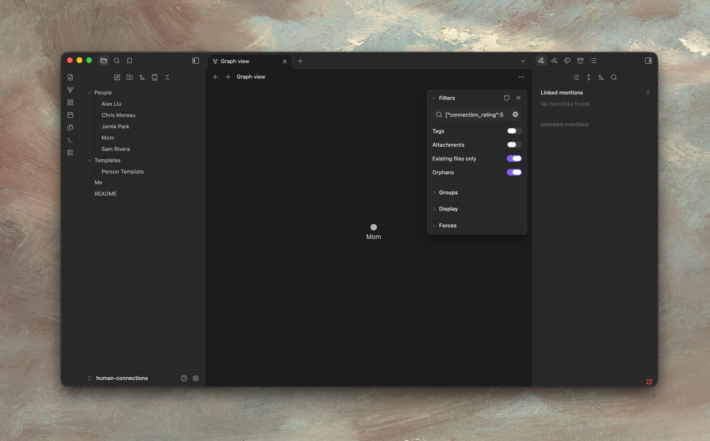

# Human connections

A little Obsidian-based system for keeping track of the people in your life. The purpose is to keep track and be aware of the meaningful and potentially meaningful connections.

## The 1–5 scale

|     | Name                | What it means                                                                                                                   |
| --- | ------------------- | ------------------------------------------------------------------------------------------------------------------------------- |
| 1   | Shared past         | The connecting context is gone and there's likely no reason to connect in the future. ex. classmates, exes, sports buddies etc. |
| 2   | Loose connection    | Peripheral conncection rather than ongoing. Can be whatever that might feel meaningful. ex. hairdresser, uni professor etc.     |
| 3   | Everyday connection | Not necessarily personally close, but involves regular meetings and conversation. ex. a colleague.                              |
| 4   | Close friend        | Willing to connect outside of forced context. ex. a friend, a gym buddy etc.                                                    |
| 5   | Inner circle        | People you share most personal matters with. ex. family, closest friends etc.                                                   |

## The graph

Open the graph view in Obsidian to see everyone connected to you at once. Each person note links back to `Me.md`, so the graph naturally forms around you as a center.

Filter by `connection_rating:5` to see only your inner circle, or by any other rating to map a slice of your world.

Exclude `path:Templates` in the graph filter so the template doesn't show up as a person.

## Files

- `Me.md` — the center of your graph
- `People/` — one Markdown file per person
- `Templates/Person Template.md` — copy this for each new person

No plugins required.
